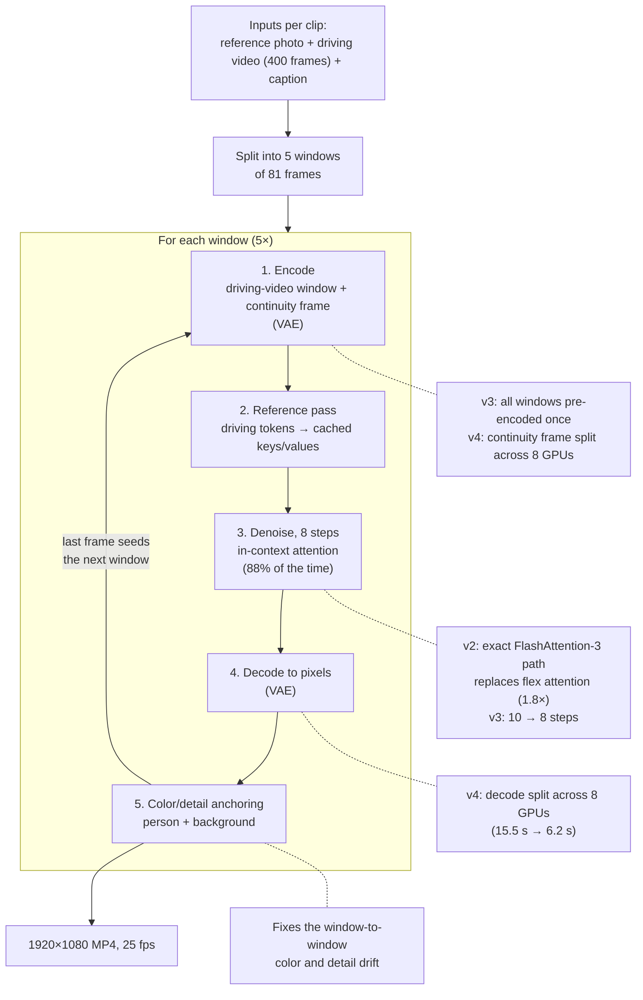
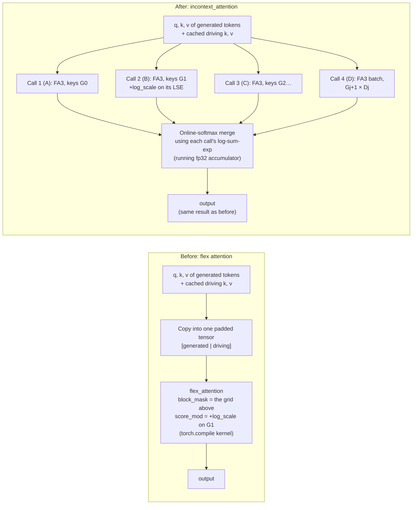

# Wan-Animate-2 at native 1080p: cost and color-drift work



**Result in one line:** native 1080p avatar video now costs **about $0.25 per output second**
(about $4 per 16 s clip). It started at about $0.50. There's no visible quality loss, and the
long-clip color and detail drift is held in check.

| | Start | Now |
|---|---|---|
| Cost per output second | ~$0.50 | **~$0.25** |
| Time per 16 s clip (8× H100) | 829 s | **420 s** |
| Background detail drift over 32 s | 2.75× | **1.32×** |
| Clips rendered successfully (final runs) | — | 19 / 19 |

---

## Contents

1. [Attention in video generation (primer)](#1-attention-in-video-generation-primer)
2. [How the model makes a video (primer)](#2-how-the-model-makes-a-video-primer)
3. [Resolution decision: native 1080p](#3-resolution-decision-native-1080p)
4. [The color-drift problem](#4-the-color-drift-problem)
5. [Cost optimizations, one by one](#5-cost-optimizations-one-by-one)
6. [What was tried and rejected](#6-what-was-tried-and-rejected)
7. [How quality was checked](#7-how-quality-was-checked)
8. [Production configuration](#8-production-configuration)
9. [Glossary](#9-glossary)

---

## 1. Attention in video generation (primer)

This section explains attention from scratch, using pictures. Everything later in the report
(in-context attention, flex vs FlashAttention, FP8) builds on it.

### 1.1 A video becomes a set of tokens

A transformer can't look at pixels directly. The video is first compressed by the VAE, then each
frame is cut into small square patches. Each patch becomes one **token**: a list of numbers
(a vector) that describes that little piece of the image.

```fig-tokens
 frame 1          frame 2          frame 3
┌──┬──┬──┬──┐   ┌──┬──┬──┬──┐   ┌──┬──┬──┬──┐
├──┼──┼──┼──┤   ├──┼──┼──┼──┤   ├──┼──┼──┼──┤      → 36 tokens in one long list
└──┴──┴──┴──┘   └──┴──┴──┴──┘   └──┴──┴──┴──┘        [t1, t2, … t36]
 12 patches       12 patches       12 patches
```

Real numbers for our 1080p videos: one frame becomes **about 8,000 tokens**, and one 81-frame
window becomes **about 176,000 tokens**.

### 1.2 What attention does: every token looks at every other token

Generating a frame means each token has to decide what it should look like. To do that it
**looks at other tokens** and borrows information from the most relevant ones. Attention is that
lookup. Each token produces three vectors:

| Vector | Plain-language role |
|---|---|
| **Query (Q)** | "What am I looking for?" |
| **Key (K)** | "What do I contain?" (a label other tokens can match against) |
| **Value (V)** | "What I'll hand over if you pick me" |

For one query token, attention does three steps:

1. **Score:** compare its query with every key. A higher score means "more relevant".
2. **Softmax:** turn the scores into weights that are positive and sum to 1. A high score gets
   most of the weight.
3. **Blend:** the token's new content is the weighted average of all the values.

**Example:** the token for the tip of the nose in frame 3 attends to other tokens.

```fig-query
query: nose tip, frame 3
key                          score   weight (softmax)
nose tip, frame 2            3.0     0.505  ██████████
nose tip, frame 1            2.4     0.277  ██████
cheek, frame 3               1.9     0.168  ███
hair, frame 3                0.5     0.041  █
background wall, frame 3    −1.0     0.009
```

The nose borrows mostly from the nose in neighboring frames. **That's how a video model keeps
the face consistent from frame to frame:** attention links the same body part across time.

### 1.3 The attention matrix, and why it's expensive

Put every query on a row and every key on a column, and you get the **attention matrix**: one
score per (query, key) pair. In a video model, attention runs across **all frames at once**
(space and time together), so the matrix is huge.

```fig-matrix
              keys: frame 1 | frame 2 | frame 3
queries frame 1   ■■■■        ■■■■      ■■■■
                  ■■■■        ■■■■      ■■■■
queries frame 2   ■■■■        ■■■■      ■■■■
                  ■■■■        ■■■■      ■■■■
queries frame 3   ■■■■        ■■■■      ■■■■
                  ■■■■        ■■■■      ■■■■
every query looks at every key: N tokens → N × N scores
```

- **Cost grows with the square of the token count.**
- 720p has about 79,000 tokens per window and 1080p about 175,000: 2.2× the tokens, but about
  **4.9× the attention work**.
- That's why attention is 63% of our run time, and why the attention kernel was the most
  important thing to optimize.

**Kernels.** The matrix itself (175,000 × 175,000 scores, per head, per layer) is far too big to
store. A **FlashAttention** kernel never builds it. It walks through the keys in tiles and keeps a
running result, using a running maximum and a running sum of the softmax. Section 1.6 shows that
trick, because we reuse it.

### 1.4 Masks: limiting who can see whom

Sometimes a token **must not** look at certain other tokens. A **mask** blocks those cells of the
matrix: they get a score of −∞, so their softmax weight is exactly 0. Another way to bend
attention is a **bias**: a constant added to the scores of some keys, which makes them more or
less attractive without fully blocking them.

### 1.5 How the driving video gets in: "in-context" attention

A motion-transfer model needs two things in every frame:
- the **identity** of the person in the reference photo;
- the **motion** of the driving video.

Wan-Animate-2 feeds the driving video in by **adding its tokens as extra keys and values** inside
the same self-attention. That's "in-context": the driving video sits in the same attention as the
video being generated. The text caption comes in separately, through a second attention
(cross-attention) to the caption's tokens.

The rule for who sees what is a mask. Here it is, simplified to 6 generated and 5 driving frames:

```mask-before
                         keys:  generated frames            | driving frames
                                G0   G1*  G2   G3   G4   G5  | D0   D1   D2   D3   D4
queries G0 (ref photo)          ■    ■    ■    ■    ■    ■   | ·    ·    ·    ·    ·
queries G1 (continuity)         ■    ■    ■    ■    ■    ■   | ■    ·    ·    ·    ·
queries G2                      ■    ■    ■    ■    ■    ■   | ·    ■    ·    ·    ·
queries G3                      ■    ■    ■    ■    ■    ■   | ·    ·    ■    ·    ·
queries G4                      ■    ■    ■    ■    ■    ■   | ·    ·    ·    ■    ·
queries G5                      ■    ■    ■    ■    ■    ■   | ·    ·    ·    ·    ■

■ allowed   · blocked   * column G1 gets the log_scale bias (−1.3)
```

**Reading the grid:**
- **Left block (generated × generated), all allowed:** every generated frame sees every other
  generated frame. This carries identity and smooth motion. G0 is the reference photo, so every
  frame can copy the person's appearance from it.
- **Right block (generated × driving), only a diagonal:** generated frame *j+1* sees only driving
  frame *j*. Each frame copies the pose of its own moment in the driving video, and nothing else.
- **Column G1, biased:** G1 is the continuity frame, the last frame of the previous window. A
  negative bias (`log_scale` = −1.3) makes the other frames lean on it a bit less, so errors
  carried over from the previous window are copied less strongly.

### 1.6 The trick that makes our version fast: splitting attention and merging it back

FlashAttention is fastest on **plain rectangles** of the matrix, with no mask inside. Our mask is
not a plain rectangle (look at the diagonal). But it can be cut into a few rectangles, each
attended separately, as long as the pieces can be merged back into exactly the result of one big
softmax.

They can. Each piece reports two things: its blended output, and the **log-sum-exp (LSE)**, the
log of its softmax denominator, which says "how much total weight this piece holds". Pieces are
then combined in proportion to their weight.

**Worked example.** One query sees three keys, with scores 2, 1 and 3 and values 10, 20 and 30.

| | Scores | Values | Output | LSE |
|---|---|---|---|---|
| All at once (one softmax) | 2, 1, 3 | 10, 20, 30 | **24.21** | — |
| Piece A (first two keys) | 2, 1 | 10, 20 | 12.69 | 2.313 |
| Piece B (third key) | 3 | 30 | 30.00 | 3.000 |
| **Merge A + B** | | | **24.21** | |

The merge weights each piece by `e^LSE`: piece A gets e^2.313 / (e^2.313 + e^3) = 0.335 of the
total, piece B gets 0.665, so 0.335 × 12.69 + 0.665 × 30 = 24.21. Same answer, exactly.

**A bias is free in this scheme:** adding `log_scale` to every score of a piece is the same as
adding it to that piece's LSE. So call B in section 5.1 runs as a normal, unbiased FlashAttention
call, and the bias is applied afterwards in one cheap step.

This is exactly what `incontext_attention` does (section 5.1): four plain FlashAttention-3 calls
plus this merge, instead of one generic masked kernel.

---

## 2. How the model makes a video (primer)

You need this section and section 1 to follow the rest. All numbers are for our 1080p setup.

### Inputs
| Input | Role |
|---|---|
| Reference photo | The person's identity, clothes and background |
| Driving video | The motion: head turns, expressions, mouth shapes (a green-screen actress) |
| Caption (`prompt`) | A per-person Chinese description of appearance and background |
| `prompt_ref` | A fixed caption that says the driving video is a motion reference |
| Continuity frame | The last frame of the previous window (none for window 1) |

There's no audio input. Mouth motion is copied visually from the driving video.

### Windows
The model can only generate **81 frames at a time**, so a 16 s clip (400 frames at 25 fps) is
made in **5 windows**. Each window starts from the last frame of the previous one (the
*continuity frame*). That's how the windows join up, and it's also why errors can build up over
time (section 4).

### Latents and tokens
- The **VAE** compresses video 8× in each spatial direction and 4× in time. An 81-frame
  1904×1072 window becomes 21 latent frames of 238×134.
- The transformer then cuts each latent frame into 2×2 patches, so **one frame is about 8,000
  tokens**.
- Per window, the generated sequence is 22 latent frames (the reference photo plus 21 video
  frames), about **176,000 tokens**. The driving video adds another ~167,000.

### The transformer and the reference pass
- The transformer has 40 layers. Each layer has self-attention with 40 heads, cross-attention to
  the text and image features, and an MLP.
- **Reference pass:** once per window, the driving-video tokens run through the transformer.
  Each layer's keys and values (K/V) are stored in a cache.
- **Denoising:** the video is then generated by **denoising**: start from noise and run the
  transformer once per step (8 steps). Each step reads the cached driving K/V.

### In-context attention
"In-context" means the driving video is given to the model as extra tokens inside the same
attention operation, rather than through a separate control network. In each layer's
self-attention, a generated token may look at:

1. **All generated tokens** (full attention across space and time). This keeps the person
   consistent.
2. **Only the driving-video tokens of its own frame.** Generated frame *j+1* sees driving frame
   *j*. This is how motion is transferred frame by frame.

On top of that, a constant bias, `log_scale`, is added to the attention scores for the
continuity frame's tokens. It's −1.3 for the Distillation model, which turns down how strongly
the window copies the carried-over frame.

### Multi-GPU split
- **Weights:** split across the 8 GPUs (FSDP).
- **Attention:** split by heads, 5 of the 40 per GPU, using all-to-all communication
  ("sequence parallel").
- **Everything else** (VAE encode/decode, color anchoring) originally ran in full on every GPU.

---

## 3. Resolution decision: native 1080p

**Question:** generate at 720p and upscale, or generate natively at 1080p?

| Option | What we saw |
|---|---|
| 720p + Real-ESRGAN (GAN upscaler) | Waxy, plastic-looking skin |
| 720p + SeedVR2 (diffusion upscaler) | Over-enhanced: invented freckles and lashes, 58% more shimmer, ~$0.12/s extra |
| **Native 1080p** | Most natural, no artifacts |

**Decision:** native 1080p ("The native 1080p is better"). It costs more, because attention grows
with the square of the token count and 1080p has 2.27× the tokens of 720p. That's why most of the
cost work below happened.

The model produces 1904×1072 (dimensions must be multiples of 16). That's resized to 1920×1080
with ffmpeg Lanczos at crf 14.

---

## 4. The color-drift problem

### 4.1 The symptom
In longer clips the person, and even more the background, became **progressively crisper,
higher-contrast and slightly brighter** from window to window. By 32 s the background looked
grainy and mottled, and the skin looked harsher.

### 4.2 Why it happens
Each window is conditioned on the **last frame of the previous window**. The model slightly
over-sharpens and brightens what it's given, and the result becomes the next window's starting
point. So a small error per window **compounds**, a bit like photocopying a photocopy.

### 4.3 How we measured it
On the same pose at the start and end of a 32 s "ping-pong" test clip (16 s forward, then
reversed, so the start and end poses match), we measured, separately for the person and the
background:

- **Lab color:** L = brightness, a/b = color. Lab is a perceptual color space, so a shift of 1 is
  roughly one just-noticeable step.
- **Detail energy:** the average absolute difference between the image and a blurred copy of
  itself (the "high-pass" band). If it rises, the image is getting crisper or grainier.

**Findings:**
- It's **mostly detail/contrast build-up**: face detail +10–40%, background detail up to 2.75×.
  On top of that there's a small brightness drift. It is not a hue cast.
- **Driving actress leakage ruled out:** an early hypothesis was that the pale, brightly lit
  driving actress was "leaking" her look into the result. The measurements didn't support that,
  so that experiment (E1) was dropped.

### 4.4 Experiments

| Exp. | What we changed | Idea behind it | Outcome |
|---|---|---|---|
| Global anchor (first fix) | Shift each window's whole-frame average color back to window 1's | Undo color drift | Stopped global color drift, but the face and detail drift remained. A whole-frame average can't see detail build-up or a small face. |
| E2a / E2b | `log_scale` −2 / −3 (default −1.3) | Lean less on the carried-over frame | Less drift, but **visible seams** at window boundaries. Rejected. |
| E4 | 121-frame windows instead of 81 | Fewer hand-offs means less compounding | Needs 8 GPUs and ~40% more cost. Rejected. |
| E5 | Anchoring color **and detail** inside a person mask | Fix the drift where it is visible | Face fixed; background still drifted |
| **E9** | E5 applied to the person **and** the background separately | Both regions drift | **Adopted** |

**E9 vs the old global anchoring** (32 s vs 1 s):

| Metric | Old (global) | E9 |
|---|---|---|
| Face detail build-up | 1.18× | 1.09× |
| Skin saturation change | −0.68 | −0.17 |
| Background detail build-up | 2.75× | 1.32× |
| Background brightness change | −0.04 L | −0.01 L |
| Brightness jump at window boundaries | 0.42 L | 0.41 L (no new seams) |

### 4.5 How the fix works (`anchor_mode="regions"`)
Code: `anchor_regions` in `pipelines/utils/color_utils.py`, called in
`pipelines/wan_animate_2_pipeline.py` after each window is decoded.

1. **Targets from window 1.** After the first window is decoded, store the Lab color and detail
   energy of the person and of the background. Those are "what it should look like".
2. **Find the person.** For every later window, a small segmentation network (DeepLabV3-MobileNet)
   produces a soft person mask per frame.
3. **Measure the drift.** Compare the window's last 16 frames with the targets, separately for the
   person and for the background. The end of the window is measured because that's where drift is
   largest and what seeds the next window.
4. **Correct each region.**
   - **Color:** add a Lab offset, clamped to ±6 in L and ±3 in a/b. The clamp makes sure that a
     real change (the person turning, a hand entering the frame) can't trigger a big false
     correction.
   - **Detail:** scale down the high-pass band (`blurred + gain × (image − blurred)`).
     - The gain is only ever below 1. We damp but never sharpen, because sharpening would amplify
       noise.
     - It's floored at 0.75 for the person and 0.5 for the background. The background barely
       changes with pose, so it can safely take a stronger correction.
5. **Ramp it in.** The correction goes from 0 at the window's first frame to 100% at its last.
   The first frame already equals the (corrected) continuity frame, so there's no visible jump.
6. **Composite** the two corrected versions through the soft mask.
7. **Keep GPUs in sync.** GPU 0's corrected frames are broadcast to all GPUs, so every GPU starts
   the next window from identical pixels.

Because the corrected frame is what seeds the next window, the error is removed **before** it can
compound.

### 4.6 Related output-quality fixes
| Problem | Cause | Fix |
|---|---|---|
| Blocky intermediate | moviepy encoded at ~541 kbps | ffmpeg libx264 **crf 10** (near-lossless). The final 1080p uses crf 14. |
| Last frame missing | moviepy writer dropped it | Same ffmpeg writer |
| Glitched first frame | The first decoded frame of every clip has wrong colors | Replace it with frame 1, and exclude it from the anchoring targets |

---

## 5. Cost optimizations, one by one

**Costs** are Modal 8× H100 time (~$35/h for 8 GPUs) per 16 s clip, divided by 16 s.

**Overview:**

| Version | Time / clip | $ / output s | What changed |
|---|---|---|---|
| Start (FA2 path) | 829 s | ~$0.50 | Native 1080p working on 8 GPUs |
| **v2** | 627 s | ~$0.38 | FlashAttention-3 + memory fixes |
| **v3** | 532 s | ~$0.32 | Precompute + 8 steps |
| **v4** | **420 s** | **~$0.25** | VAE work split across GPUs + startup fixes |

### 5.1 `incontext_attention`: an exact replacement for flex attention
File: `wanxiang/models/attention.py` (`incontext_attention`), used in
`wanxiang/models/wan_animate_2_model.py` (`forward_gen`).

**What it is.** The function that computes the in-context attention described in sections 1 and 2:
generated tokens attend to all generated tokens, plus their own frame's driving tokens, plus the
`log_scale` bias on the continuity frame.

**What the original code did.** It placed all queries and keys into one large padded tensor and
called PyTorch's **flex attention**, a generic kernel that takes:
- a *block mask* (which keys each query may see);
- a *score_mod* function (the `log_scale` bias).

The kernel is generated by `torch.compile` (in max-autotune mode) the first time it runs.

**Why we replaced it.**
1. **It locks us out of the fastest kernels.** Flex is a generic, compiled kernel. The
   hand-tuned FlashAttention kernels, especially FlashAttention-3 on H100, are faster but don't
   support arbitrary masks and score modifiers.
2. **It was slower.** At 720p the dense FlashAttention-2 path already took 3.58 s of attention per
   step, against 4.23 s for flex.
3. **It broke on the Base model.** In a microbenchmark, flex failed with `log_scale = 0.0` (the
   Base model's setting).
4. **Compile cost:** the max-autotune compile runs on the first window of every container.

#### Before vs after, as a picture

**The attention pattern (the "mask")** is the same before and after; only how it's computed
changes. Each row is a group of queries (one generated frame) and each column is a group of keys.
A filled cell means "these queries may look at these keys".

The pictures are simplified to 6 generated frames (G0–G5) and 5 driving frames (D0–D4). The real
model has 22 and 21, about 8,000 tokens each.

**Before: one masked flex-attention kernel.** All keys sit in one padded tensor
`[generated | driving]`. A single compiled flex kernel walks the whole grid, skips the blocked
cells using the block mask, and adds `log_scale` to column G1 with `score_mod`.

```mask-before
                         keys:  generated frames            | driving frames
                                G0   G1*  G2   G3   G4   G5  | D0   D1   D2   D3   D4
queries G0 (ref photo)          ■    ■    ■    ■    ■    ■   | ·    ·    ·    ·    ·
queries G1 (continuity)         ■    ■    ■    ■    ■    ■   | ■    ·    ·    ·    ·
queries G2                      ■    ■    ■    ■    ■    ■   | ·    ■    ·    ·    ·
queries G3                      ■    ■    ■    ■    ■    ■   | ·    ·    ■    ·    ·
queries G4                      ■    ■    ■    ■    ■    ■   | ·    ·    ·    ■    ·
queries G5                      ■    ■    ■    ■    ■    ■   | ·    ·    ·    ·    ■

■ allowed   · blocked   * column G1 gets the log_scale bias (−1.3)
→ one flex_attention(q, k, v, block_mask, score_mod), compiled with torch.compile
```

**After: the same grid, cut into four dense rectangles.** Each colored region is a plain
rectangle (or a stack of small squares) with no mask inside, so FlashAttention-3 can compute it
at full speed. The results are then merged exactly.

```mask-after
                         keys:  generated frames            | driving frames
                                G0   G1   G2   G3   G4   G5  | D0   D1   D2   D3   D4
queries G0 (ref photo)          A    B    C    C    C    C   | ·    ·    ·    ·    ·
queries G1 (continuity)         A    B    C    C    C    C   | D    ·    ·    ·    ·
queries G2                      A    B    C    C    C    C   | ·    D    ·    ·    ·
queries G3                      A    B    C    C    C    C   | ·    ·    D    ·    ·
queries G4                      A    B    C    C    C    C   | ·    ·    ·    D    ·
queries G5                      A    B    C    C    C    C   | ·    ·    ·    ·    D

A = call 1: all queries × frame G0 keys
B = call 2: all queries × frame G1 keys, then + log_scale on its log-sum-exp
C = call 3: all queries × frames G2…G5 keys (≈90% of the work)
D = call 4: one batched call of small per-frame attentions (Gj+1 × Dj)
```

**The computation, step by step:**



| | Before (flex) | After (`incontext_attention`) |
|---|---|---|
| Kernel | One generic masked kernel, generated by `torch.compile` | 4 dense FlashAttention calls, no mask inside any of them |
| Bias (`log_scale`) | Added to each score inside the kernel | Added once to call B's log-sum-exp (mathematically the same) |
| Can use FA3 | No | Yes |
| Attention time per step | 4.23 s (720p) | 3.58 s with FA2 (720p); a further 1.8× with FA3 |
| Base model (`log_scale` 0) | Failed | Works |
| Result | — | Identical (checked numerically) |

**How it works.** The masked attention splits into a few **dense** attention calls that
FlashAttention can run directly:

| Key group | Who attends | Note |
|---|---|---|
| Generated frame 0 (reference photo) | all generated queries | |
| Generated frame 1 (continuity frame) | all generated queries | `log_scale` added afterwards (see below) |
| Generated frames 2–21 | all generated queries | the big one: ~90% of the work |
| Driving frame *j* | generated frame *j+1* only | run as a batch of 21 small per-frame attentions |

Softmax over the union of all these keys is reconstructed exactly from the pieces:

- Each FlashAttention call returns its output and its **log-sum-exp (LSE)**: the log of the
  softmax denominator over that group.
- Two partial results with outputs `o₁, o₂` and LSEs `l₁, l₂` combine as
  `o = (e^{l₁}·o₁ + e^{l₂}·o₂) / (e^{l₁} + e^{l₂})`. This is computed with a running maximum for
  numerical stability ("online softmax", the same trick FlashAttention uses internally).
- Adding `log_scale` to a group's LSE is exactly the same as adding it to every score in that group.

**Streaming merge.** Each partial result is folded into a single fp32 accumulator as soon as it's
computed, so we never hold all partial outputs at once. That keeps peak memory low enough for
1080p.

**Exactness.**
- It's mathematically the same computation, checked numerically against the original flex call at
  small sizes, including the padded case.
- One quirk was kept on purpose: the original layout pads each frame to a fixed slot size with
  zero-valued keys, and those zero keys do take part in the softmax. The new path reproduces that,
  so outputs match the original model's behavior.

**Result.** About 15% faster attention by itself, but the main win is that it made the next step
possible.

### 5.2 FlashAttention-3 (`WAN_ATTN=fa3`)
**What it is.** The H100 ("Hopper") generation of FlashAttention. It uses Hopper-only hardware
features (asynchronous TMA memory copies, warp specialization) to run attention close to the
GPU's peak.

**Why.** Attention is about 63% of every denoise step, so the attention kernel is the biggest
lever. `incontext_attention` needs each call's LSE, which FA3's low-level forward function
returns.

**What we did.**
- Built FA3 from source in the Modal image, compiling only the kernels this model needs (forward
  only, bf16, head size 128) so the build stays short.
- FlashAttention-2 is still used for the small variable-length cross-attention calls.

**Result.**
- Attention is **1.8× faster** and exact.
- Per clip: 829 s → 642 s, **$0.50 → $0.38 per output second**.
- In a profile, the FA3 kernel runs at about 660 TFLOPS, near the H100's practical bf16 limit.

### 5.3 Memory fixes (needed to fit 1080p)
At 1080p the driving-video K/V cache alone is tens of GB, so memory was the first wall.

| Fix | Why it was needed | Effect |
|---|---|---|
| Store the K/V cache as compact bf16 copies (`.clone()`) | The cached K and V were *views* into the big combined QKV buffer, so caching them silently kept the whole buffer (including Q) alive for all 40 layers | Cache half the size; Q freed |
| Free the K/V cache before decoding | Decoding doesn't need it, and VAE decode at 1080p needs a lot of memory | Decode fits |
| `clear_cache()` after VAE encode/decode | The VAE's causal feature cache from the last chunk stayed allocated | ~10 GB freed per GPU |
| Streaming LSE merge (5.1) | Holding all partial attention outputs at once is several GB | Lower peak |

### 5.4 Duplicate VAE encode removed
The pipeline encoded the same driving-video frames **twice** per window: once as
`condition_latents` and once more for `condition_y`. Those are identical pixels with an identity
resize. The second pass now reuses the first. The output is identical and the work is gone.

### 5.5 Precompute (`WAN_PRECOMPUTE=1`, v3)
**What.** Before the window loop:
- All 5 driving-video windows are VAE-encoded once. The windows are spread round-robin over the
  GPUs, and the results are broadcast to all of them.
- The reference-photo latent, the CLIP image features and the T5 text embeddings are computed once
  and reused for every window.

**Why.** These inputs don't depend on what was generated. Previously each was recomputed in every
window, on every GPU.

**Result.** Bit-identical output, about 5% faster.

### 5.6 8 denoising steps instead of 10 (v3)
**What.** The Distillation model is trained for few-step sampling; we tested 10, 8 and 6 steps.

| Steps | Time per window | vs 10 steps |
|---|---|---|
| 10 | 108 s | reference |
| **8** | 93 s | PSNR 37.7 dB, detail 3.53 vs 3.57: indistinguishable |
| 6 | 79 s | PSNR 34.4 dB, slightly softer skin |

**Result.** 8 steps is the sweet spot: **$0.32 per output second** for v3. Across all 19 clips, v3
vs v2 scores SSIM 0.987 and PSNR 41.7 dB; the lowest-scoring clips differ only in tiny pose
differences.

### 5.7 VAE work split across GPUs (`WAN_SPLIT_VAE=1`, v4)
**Problem.** After every window, all 8 GPUs ran the *same* full-frame VAE work:
- decoding the window (~12 s);
- encoding the continuity frame (~7.4 s).

That's about 20 s per window where 7 of the 8 GPUs duplicated work.

**What we did: column strips with a halo.**
- Each GPU decodes only a vertical strip, 1/8 of the frame width, and the strips are gathered
  over NCCL.
- Most of the VAE is convolution, which only looks at nearby pixels. So a strip can be computed
  on its own if it includes a margin (**halo**) of extra columns on each side, 12 latent columns
  (96 px). The halo is discarded afterwards.
- The VAE's middle block has a *frame-global* attention layer. That part runs on the full width
  on every GPU, which is cheap because it's at 1/8 resolution. Only the expensive high-resolution
  stages are split.
- The continuity-frame encode is split the same way. The strips are gathered just before the
  global middle block.

Code: `decode_cols`, `encode_cols`, `forward_pre`/`forward_post` and
`forward_down`/`forward_up` in `wanxiang/models/vae.py`; `_gather_cols` in the pipeline.

**Exactness.**
- Not bit-identical: differences of at most 1/255 on about 4% of pixels.
- The difference was the same for halos of 8, 12, 16 and 24, so it's bf16/cuDNN rounding from
  different tensor shapes, not a too-small halo.

**Two smaller startup fixes, same version:**
- **Driving-video resize:** resizing 400 frames from 1920×1080 to the model size took ~15 s on
  CPU on every GPU process. Now each GPU resizes 1/8 of the frames and they exchange results.
  17 s → 5 s per clip.
- **Unused batch:** each window built a 4 GB float64 copy of its 81 driving frames that
  precompute had made unnecessary. It's no longer built, saving ~2–3 s per window.

**Result:**

| Per window | v3 | v4 |
|---|---|---|
| Prep (continuity-frame encode) | 8.8 s | 2.7 s |
| Denoise | 69.6 s | 69.6 s |
| Decode + anchoring | 15.5 s | 6.2 s |

- Per clip: 532 s → **420 s**, **$0.32 → $0.25 per output second**.
- v4 vs v3 over all 19 clips: SSIM 0.993, PSNR 48.6 dB, which is visually identical.

### 5.8 Where the time goes now
Profile of one denoise step on 8× H100 (7.6 s of GPU time):

| Component | Share |
|---|---|
| FA3 attention | 63% |
| Elementwise ops and copies (RoPE in float64, dtype casts, padding) | ~21% |
| Linear layers (matrix multiplies) | 9.5% |
| NCCL communication between GPUs | 4.7% |

- Denoising is 88% of each window.
- Attention already runs near the hardware limit.
- Each remaining slice is small.

That's why lossless speedups are essentially exhausted (section 6).

---

## 6. What was tried and rejected

| Idea | What happened | Why rejected |
|---|---|---|
| SageAttention (INT8/FP8 attention) | sm90 CUDA kernels produced garbage in our build; the Triton version worked | Only 1.2× faster |
| FP8 attention in FA3 (`WAN_ATTN=fa3fp8`) | Kernel 1.48× faster, clip −10% | Output drifted to 27 dB vs v4: overexposed skin, harsher face, identity drift |
| Exact elementwise cleanups (cache rotated reference keys, bf16 padded inputs) | Bit-identical | Only −0.5%. Kept, since they're harmless. |
| 4 GPUs per clip | Out of memory during denoising (78 GB peak) | Would only save ~9% |
| 6 steps | −20% time | Slightly softer skin |
| `log_scale` −2 / −3 | Less drift | Seams between windows |
| 121-frame windows | Less drift | ~40% more cost |
| Base model | — | 40 steps plus guidance: roughly 6–8× the cost of Distillation |
| 720p + upscaling | — | Waxy (ESRGAN) or over-enhanced (SeedVR2) |

**Remaining levers, if it must get cheaper (all trade some quality):**
- 6 steps: ~$0.20/s, slightly softer skin.
- Step caching (reusing nearly identical denoise steps): ~−20–30%, may soften motion.
- 4 GPUs with more memory work: ~−9%, lossless, significant engineering.

---

## 7. How quality was checked

- **Against the previous version:** every version was compared with the one before it, with the
  same seed and inputs, using SSIM and PSNR over all 400 frames, overall and per window. This
  shows whether differences grow across windows.
- **Visually:** side-by-side crops of the worst-scoring frames, plus a contact sheet of all 19
  avatars at the head-tilt moment (frame 260).
- **Bit-exact checks:** for changes meant to be exact (precompute, cleanups), the decoded frames
  were hashed and compared.
- **Drift:** Lab color and detail energy for person and background on the 32 s ping-pong clip
  (section 4.3).

**PSNR rule of thumb here:**
- above ~45 dB: rounding-level, invisible;
- ~35–42 dB: tiny pose or texture differences, not visible side by side;
- below ~30 dB: visibly different (as with FP8).

---

## 8. Production configuration

```bash
export PATH=/opt/conda/envs/wan_animate_2/bin:$PATH
WAN_SPLIT_VAE=1 WAN_PRECOMPUTE=1 WAN_ATTN=fa3 WAN_GPU='H100:8' modal run modal_app.py::batch \
  --frames-dir first_frames --driving motion_25fps.mp4 --out-dir results_v4/steps8 \
  --width 1080 --height 1920 --short-side 0 --final-size 1920x1080 --steps 8 --max-containers 3
```

| Setting | Value |
|---|---|
| Model | Wan-Animate-2 **Distillation** |
| Steps | 8 |
| GPUs | 8× H100 per clip, up to 3 clips in parallel |
| Attention | FA3 via `incontext_attention` |
| Color anchoring | `regions` (person + background) |
| Captions | One per avatar (`first_frames/captions.json`) |
| Seed | 42 |

**Outputs:** `results_v2/` (baseline), `results_v3/steps8/`, `results_v4/steps8/`.
**Detailed run numbers:** `results_v3/benchmark.md`.

---

## 9. Glossary

| Term | Meaning |
|---|---|
| **Window** | One 81-frame chunk the model generates at a time |
| **Continuity frame** | The previous window's last frame, used to start the next window |
| **Latent** | The VAE's compressed representation of video (8× smaller per side, 4× in time) |
| **Token** | One 2×2 patch of a latent frame; the unit attention works on (~8,000 per frame at 1080p) |
| **VAE** | The encoder/decoder between pixels and latents |
| **Denoising step** | One pass of the transformer that refines the video from noise |
| **K/V cache** | Stored keys/values of the driving-video tokens, computed once per window |
| **In-context attention** | Attention where driving-video tokens sit in the same attention as the generated tokens |
| **`log_scale`** | Bias on attention to the continuity frame; more negative means less copying |
| **Flex attention** | PyTorch's generic masked-attention kernel, compiled on first use |
| **FlashAttention (FA2/FA3)** | Hand-tuned fast attention kernels; FA3 is H100-specific |
| **LSE (log-sum-exp)** | Log of a softmax denominator; lets partial attentions be merged exactly |
| **Halo** | Extra border columns computed so a strip's edges come out correct |
| **Lab** | Perceptual color space: L brightness, a/b color |
| **Detail energy** | Mean high-pass magnitude; rises when an image gets crisper or grainier |
| **PSNR / SSIM** | Similarity scores between two videos (higher means more similar) |
| **bf16 / FP8** | 16-bit and 8-bit number formats; lower precision is faster but less accurate |
